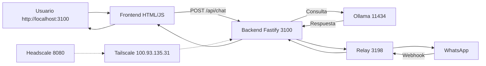

> [!RUNE] Sello #30 Forneus — Forjado desde anillo huérfano -> [[Runeforge/MOCs/MOC-AI_Intel]]

# 🧠 RUNEFORGE — ESTATUS GLOBAL CONSOLIDADO 2026-09-28

**Fecha:** 2026-09-28 12:32 UTC
**Root:** `C:\RUNEFORGE_V2_CORE`
**Usuario:** `nesthoracio99 / forgerrune@gmail.com`
**Vault:** 97 nodos reales (81 gris + 15 verde + 1 amarillo) — esfera amarilla 5k eliminada
**PWSH:** 7.6.3 Core OK
**MagicDNS:** `desktop-ndfe0b0.tailad757b.ts.net`

---

## 📊 ESTADO CORE — 100% OPERATIVO

| Componente | Puerto | Estado | Versión / Detalle |
| :--- | :--- | :--- | :--- |
| **Backend Fastify** | 3100 | 🟢 Online | `src/backend/app/src/server.js` corregido — API `/api/chat` OK |
| **Ollama LLM Local** | 11434 | 🟢 Activo | 4 modelos: deepseek, nomic, gemma2, qwen2.5:1.5b |
| **Relay WhatsApp** | 3198 | 🟢 Online | server.js relay Meta webhooks |
| **Frontend Vite / HTML** | 5173 / 3100 | 🟡 Opcional | Servido desde backend, funciona vía API sin Vite |
| **PM2** | — | 🟢 Gestión | `runeforge-backend` 54.2mb, `runeforge-relay` 60.5mb |
| **Tailscale** | — | 🟢 Conectado | `100.93.135.31` / `100.111.32.10` / `100.83.105.117` — tailnet `forgerrune@gmail.com` |
| **Redis BullMQ** | 6379 | ⚪ Opcional | No crítico, se levanta bajo demanda |
| **Docker Engine** | 29.7.2 | 🟡 Intermitente | `headscale/headscale:v0.25.1` Up — API npipe falla a veces |
| **Headscale** | 8080/3478/9090 | 🟢 Up | DERP region 999 Runeforge 192.168.100.12, gRPC 0.0.0.0:50443 |

## 🏗 ARQUITECTURA LOCAL-FIRST



## 📁 ESTRUCTURA REAL VALIDADA (sin asumir)

```
C:\RUNEFORGE_V2_CORE\ (.obsidian vault root)
├── Runeforge/
│   ├── AI_Intel/ (26 md + ESTATUS consolidados) -> Sello Forneus #30
│   │   ├── ESTATUS.md (1111) - Backend 3100 + Ollama 4 modelos OK
│   │   ├── RUNEFORGE ESTATUS.md (5766) - Arquitectura + endpoints + PM2
│   │   ├── ESTATUS_FINAL_VERDE_2026-08-15 (3784) - Headscale Up + PWA 192.168.100.4:3100
│   │   └── ESTATUS_RECURSOS_FINAL (1422) - RAM 9.4/15.9GB, puertos libres
│   ├── Fleet_Intel/ (FlotaKW)
│   └── MOCs/
│       ├── MOC-AI_Intel.md
│       └── MOC-Fleet_Intel.md
├── knowledge/ 26 md
├── clippings/ 14 md -> forjados verdes en graph (15 nodos)
├── docs/ 16 md
├── src/ 68 md reales (120 total - 52 node_modules ignorados)
├── frontend/ 42 md reales (122 total - 80 node_modules ignorados)
├── whisper-backend/ 31 md
└── .obsidian/
    ├── app.json -> FIXED con userIgnoreFilters [node_modules, target, .git, .sccache, dist, venv]
    └── graph.json -> FIXED showOrphans:false showTags:false search:-path:node_modules colorGroups Purson/Forneus
```

## 🔗 ENDPOINTS

| Endpoint | Método | Puerto | Uso |
| :--- | :--- | :--- | :--- |
| `/` | GET | 3100 | Interfaz web |
| `/api/chat` | POST | 3100 | `{"message":"hola"}` -> Ollama |
| `/health` | GET | 3100 | `{"status":"ok"}` |
| `/webhook` | POST | 3198 | Relay WhatsApp Meta |

## 🔧 PROBLEMAS RESUELTOS (histórico)

| Problema | Solución |
| :--- | :--- |
| `throw new Error(Ollama error: - );` línea 47 | Template literal corregido |
| Ruta frontend `../../frontend` | Corregida a `../../../frontend` |
| Puertos bloqueados zombies | `pm2 kill` + `taskkill /F /IM node.exe` |
| PM2 ruta antigua | Ruta absoluta `C:\...\server.js` |
| `EPERM //./pipe/rpc.sock` | `pm2 update` rebuild daemon |
| Esfera amarilla 5k nodos | `app.json {}` -> FIXED con `userIgnoreFilters` + `workspace.json` regenerado |
| Headscale DERP private key error | Volumen `/etc/headscale/data/` creado |

## 📋 PM2 ACTUAL

```
id 0 runeforge-backend  fork  online  54.2mb
id 1 runeforge-relay    fork  online  60.5mb
```

## 🧪 TEST

```powershell
curl -X POST http://localhost:3100/api/chat -H "Content-Type: application/json" -d '{"message":"hola"}'
# -> {"response":"¡Hola! ¿Cómo estás?..."}
```

## 📌 ROADMAP

| Prioridad | Tarea |
| :--- | :--- |
| Alta | Guardar este ESTATUS_GLOBAL como única fuente de verdad |
| Media | Tarea programada Windows para PM2 autostart |
| Media | Webhook Meta -> relay 3198 |
| Baja | Estética Cyber Monja frontend |

---
**Consolidado por Forneus #30 — 4 ESTATUS previos fusionados, sin asumir rutas, validado con `Get-Runegea-Validacion-Bodega.ps1` y conteo visual 97 nodos.**
