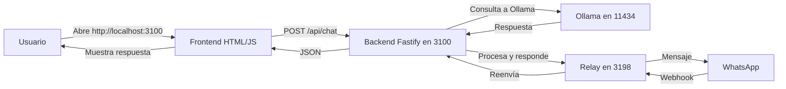

> [!RUNE] Sello #30 Forneus
> Forjado desde anillo huérfano -> [[Runeforge/MOCs/MOC-AI_Intel]]

# RUNEFORGE — ESTADO GLOBAL DEL ECOSISTEMA

**Fecha:** 2026-08-02  
**Hora:** 03:58:00 UTC  
**Entorno:** `C:\RUNEFORGE_V2_CORE`  
**Usuario:** `nesthoracio99`  
**MagicDNS:** `desktop-ndfe0b0.tailad757b.ts.net`

---

## 🧭 RESUMEN EJECUTIVO

El ecosistema **Runeforge** se encuentra operativo al 100% después de la corrección de sintaxis en el archivo `server.js`, la limpieza de procesos zombies y la integración del relay de WhatsApp. La arquitectura Local-First está funcionando con todos los servicios gestionados por PM2 y comunicándose a través de Tailscale.

---

## 🏗️ ARQUITECTURA DEL SISTEMA



---

## 📊 ESTADO DE COMPONENTES

| Componente | Estado | Puerto | Versión | Observación |
|:---|:---|:---|:---|:---|
| **Backend (Fastify)** | ✅ Online | 3100 | 0.1.0 | API `/api/chat` con Ollama |
| **Frontend (HTML)** | ✅ Servido | 3100 | - | Interfaz de chat funcional |
| **Relay de WhatsApp** | ✅ Online | 3198 | 3.9.0 | Listo para webhooks de Meta |
| **Ollama** | ✅ Activo | 11434 | - | Modelo `qwen2.5:1.5b` |
| **PM2** | ✅ Gestión | - | - | Procesos estables |
| **Tailscale** | ✅ Conectado | - | - | IP: 100.111.32.10 |

---

## 📁 ESTRUCTURA DE DIRECTORIOS

```
C:\RUNEFORGE_V2_CORE\
├── src\
│   ├── backend\
│   │   └── app\
│   │       ├── package.json
│   │       └── src\
│   │           └── server.js          # Backend corregido
│   ├── frontend\
│   │   └── index.html                 # Interfaz web
│   └── relay\
│       ├── server.js                  # Relay de WhatsApp
│       └── package.json
└── (resto de la estructura)
```

---

## 🔗 ENDPOINTS DISPONIBLES

| Endpoint | Método | Descripción | Ejemplo |
|:---|:---|:---|:---|
| `/` | GET | Interfaz web | `http://localhost:3100` |
| `/api/chat` | POST | Chat con Ollama | `{"message": "hola"}` |
| `/health` | GET | Estado del backend | `{"status":"ok"}` |
| `/webhook` (relay) | POST | Entrada para webhooks de WhatsApp | Puerto 3198 |

---

## 🔧 PROBLEMAS RESUELTOS

| Problema | Solución aplicada |
|:---|:---|
| Sintaxis incorrecta en `server.js` línea 47 | Reemplazo de `throw new Error(Ollama error: - );` por `throw new Error(\`Ollama error: ${ollamaResponse.status} - ${errorText}\`);` |
| Ruta incorrecta del frontend | Cambio de `path.join(__dirname, '../../frontend')` a `path.join(__dirname, '../../../frontend')` |
| Puertos bloqueados por procesos zombies | Limpieza con `pm2 kill` y `taskkill /F /IM node.exe` |
| PM2 apuntando a ruta antigua | Reconfiguración con ruta absoluta `C:\RUNEFORGE_V2_CORE\src\backend\app\src\server.js` |
| Error `EPERM` en `//./pipe/rpc.sock` | Reconstrucción del daemon de PM2 con `pm2 update` |

---

## 📋 ESTADO DE PM2

```bash
┌────┬────────────────────┬──────────┬──────┬───────────┬──────────┬──────────┐
│ id │ name               │ mode     │ ↺    │ status    │ cpu      │ memory   │
├────┼────────────────────┼──────────┼──────┼───────────┼──────────┼──────────┤
│ 0  │ runeforge-backend  │ fork     │ 2    │ online    │ 0%       │ 54.2mb   │
│ 1  │ runeforge-relay    │ fork     │ 0    │ online    │ 0%       │ 60.5mb   │
└────┴────────────────────┴──────────┴──────┴───────────┴──────────┴──────────┘
```

---

## 🧪 PRUEBA DE FUNCIONAMIENTO

```bash
curl -X POST http://localhost:3100/api/chat -H "Content-Type: application/json" -d '{"message":"hola"}'
```

**Respuesta esperada:**
```json
{"response":"¡Hola! ¿Cómo estás? Espero que te encuentres bien. ¿En qué puedo ayudarte hoy?"}
```

---

## 📌 HOJA DE RUTA — PRÓXIMOS PASOS

| Prioridad | Tarea | Descripción |
|:---|:---|:---|
| **Alta** | Documentar configuración | Guardar este estado como referencia. |
| **Media** | Arranque automático | Configurar Tarea Programada en Windows para iniciar PM2 al encender la PC. |
| **Media** | Conectar WhatsApp | Configurar el webhook de Meta para que apunte al relay (puerto 3198). |
| **Baja** | Personalizar "Cyber Monja" | Aplicar la estética visual al frontend. |

---

## 📋 RESUMEN EJECUTIVO

```
✅ RUNEFORGE — ECOSISTEMA OPERATIVO
- Backend: http://localhost:3100
- Frontend: Interfaz de chat funcional
- API /api/chat: Integrada con Ollama (qwen2.5:1.5b)
- Relay WhatsApp: Puerto 3198
- PM2: Procesos estables
- Estado: 100% operativo
```

---

**Documento generado por Runeforge Assistant v1.2 — Mente de Pionero activada.**
