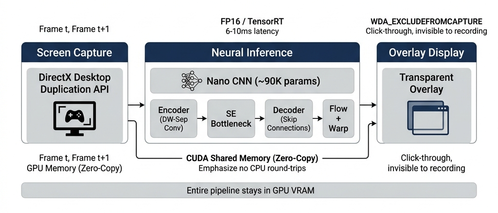
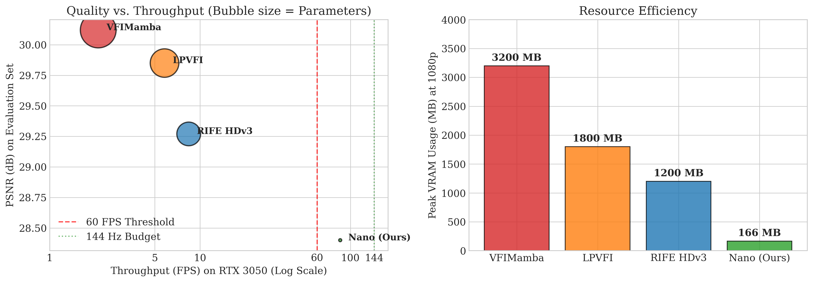
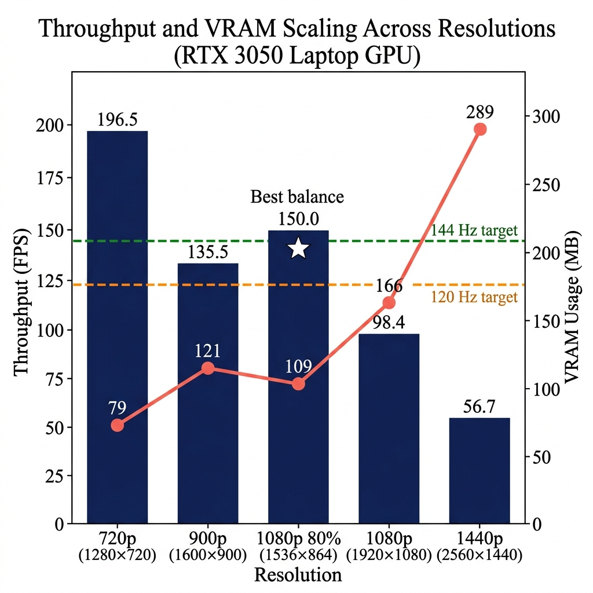

# Open-Frame-gen

**Real-Time Video Frame Interpolation on Constrained Consumer Hardware**

[](LICENSE)

Open-Frame-gen is a complete real-time video frame interpolation (VFI) system for entry-level consumer GPUs. It pairs an ultra-lightweight CNN (**Nano**, ~90K parameters — 63× smaller than RIFE HDv3) with a GPU-resident C++ pipeline (DirectX Desktop Duplication capture → TensorRT FP16 inference → transparent overlay), achieving **100–200 FPS at 1080p on an RTX 3050 Laptop GPU** with under 200 MB of VRAM.

This repository is the companion code for our paper:

> *Open-Frame-gen: Real-Time Video Frame Interpolation on Constrained Consumer Hardware* — Prithivi Nair, Prajwal R, Madhav S, Rashmi N Ugarakhod (PES University), JSCCE 2026. ([PDF](Deep_Learning_paper.pdf))



## Results

| Method | Params | FPS (1080p)* | PSNR |
| --- | --- | --- | --- |
| VFIMamba-S | 16.8 M | 1.1 ± 0.1 | **30.12** |
| RIFE HDv3 | 5.66 M | 8.4 ± 0.2 | 29.27 |
| **Nano (Ours)** | **89.9 K** | **101.1 ± 2.4** | 28.40 |

<sub>*Model-only inference on RTX 3050 Laptop GPU (4 GB). FP16 (Nano), FP32 (baselines).</sub>




## Repository layout

| Path | Purpose |
| --- | --- |
| `src/` | Core Python library: `nano.py` (Nano model + engine), `capture.py`, RIFE baseline (`RIFE_HDv3.py`, `IFNet_HDv3.py`, `model.py`, `refine.py`) |
| `scripts/` | Runnable tools: ONNX export, benchmarks, dataset capture, RIFE live test |
| `ui/` | Python demo — full overlay UI with controls and metrics (`ui_overlay.py`) |
| `notebooks/` | `training.ipynb` — Nano training pipeline |
| `checkpoints/` | Released weights: `nano_v17_best.pth` (PyTorch), `nano_v16.onnx` (TensorRT input) |
| `engine_cpp/` | C++ TensorRT pipeline (D3D11 capture, CUDA interop, inference, overlay) |
| `figures/` | Paper figures |

## Installation (Python)

- Windows 10/11, NVIDIA GPU with CUDA
- Python 3.10+

```bash
pip install -r requirements.txt
```

Install a CUDA-enabled PyTorch build from [pytorch.org](https://pytorch.org/get-started/locally/) if `pip` gives you the CPU-only wheel.

## Quick start — Python demo

```bash
python ui/ui_overlay.py
```

Weights ship in `checkpoints/nano_v17_best.pth`; no setup needed. The overlay captures the desktop via DXCam, interpolates with Nano, and renders through an OpenGL widget with FPS/quality controls.

## C++ / TensorRT pipeline

Prerequisites: Visual Studio 2022 (C++ build tools), CMake, CUDA Toolkit, TensorRT 10.

1. Download the [TensorRT 10 Windows ZIP](https://developer.nvidia.com/tensorrt) and extract it to `TensorRT/` at the repo root (it is gitignored — the SDK cannot be redistributed here).
2. Build:
   ```bat
   cd engine_cpp
   build_release.bat
   ```
   The script copies `checkpoints/nano_v16.onnx` next to the executable; on first run the engine compiles a GPU-specific `.engine` plan (cached for subsequent runs).

   Building manually with CMake instead? Copy `checkpoints/nano_v16.onnx` into `engine_cpp/build/Release/` yourself — the engine loads the model from its own directory.
3. Run:
   ```
   engine_cpp\build\Release\OpenFrameGen.exe
   ```

**Overlay hotkey:** `Ctrl+Shift+O` toggles overlay visibility. Use the UI controls to change target FPS, quality (Auto-Quality adaptive resolution), sharpness, and split/preview modes.

## RIFE baseline

`scripts/live_test.py` runs the RIFE HDv3 baseline for comparison. RIFE weights are not shipped — download `flownet.pkl` from the official [Practical-RIFE](https://github.com/hzwer/Practical-RIFE) v4.25 release and place it at `src/flownet.pkl`.

## Training & data

The training dataset is not shipped. To reproduce:

1. `python scripts/dataset_cap.py` — record frame triplets from your screen into `dataset/raw/`
2. `python scripts/rife_outputs.py` — (optional) bake RIFE teacher targets (requires `src/flownet.pkl`)
3. `notebooks/training.ipynb` — train Nano (saves to `checkpoints/`)
4. `python scripts/export_onnx.py` — export the trained model to ONNX for TensorRT

## Benchmarks

```bash
python scripts/paper_benchmark.py   # model-only latency/FPS/quality tables from the paper
python scripts/video_benchmark.py  # per-video quality benchmark
```

Both require a recorded dataset at `dataset/raw/images` (see Training & data) and, for the RIFE comparison, `src/flownet.pkl`.

## Citation

```bibtex
@inproceedings{nair2026openframegen,
  title     = {Open-Frame-gen: Real-Time Video Frame Interpolation on Constrained Consumer Hardware},
  author    = {Nair, Prithivi and R, Prajwal and S, Madhav and Ugarakhod, Rashmi N},
  booktitle = {JSCCE 2026},
  year      = {2026}
}
```

## License & acknowledgements

Released under the [MIT License](LICENSE).

The RIFE baseline files in `src/` (`RIFE_HDv3.py`, `IFNet_HDv3.py`, `model.py`, `refine.py`) are adapted from [RIFE](https://github.com/hzwer/ECCV2022-RIFE) / [Practical-RIFE](https://github.com/hzwer/Practical-RIFE), © Megvii Inc. / hzwer, MIT License.
